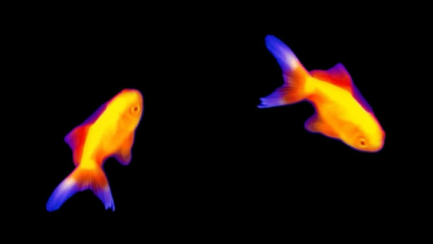

  
  

  

# hello, world! 
<b>estudante de sistemas de informação | 2024 - 2027 | projetos acadêmicos e pessoais<b>

<table width="100%">
  <tr>
      
      &nbsp;  
        
  </tr>

  
        
</table>

 
  
  
  
  
  
  
   

  
  ##
  

